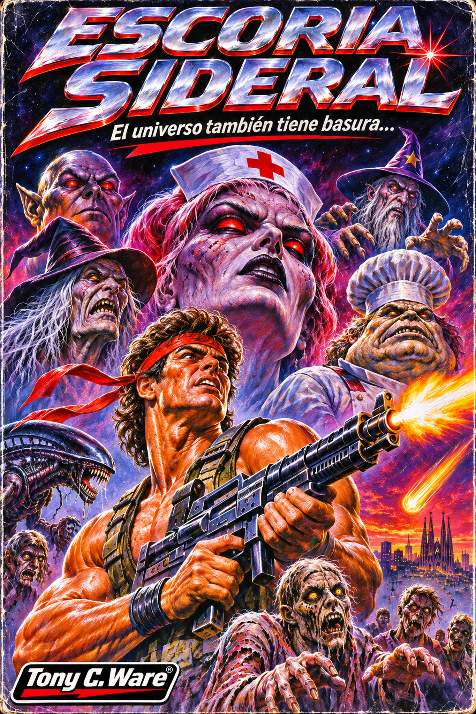
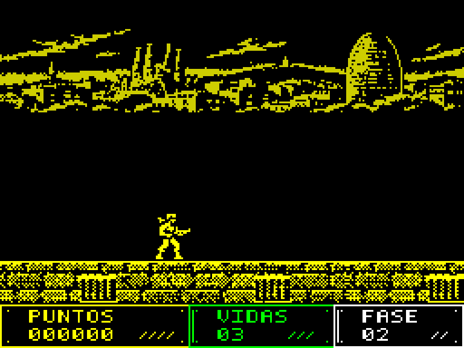

# ESCORIA SIDERAL

**El universo también tiene basura…**

**V1.0.1 · ZX Spectrum 48K · 2026 Tony C. Ware**

1988, el presente. Tras la caída de un meteoro en Barcelona, los muertos salen de sus tumbas y extrañas criaturas siembran el terror. Ace Wisconsin, exguerrillero y operativo militar del CNI, recibe la misión de detener el ataque. No sabe ni si mañana saldrá el sol.

## Descargas

- [TAP V1.0.1](JUEGO/ESCORIA_SIDERAL_V1.0.1.tap)
- [Manual, atlas y memoria técnica V1.0.1](DOCUMENTACION/ESCORIA_SIDERAL_V1.0.1_ATLAS_MANUAL_MEMORIA.pdf)
- [Release y paquete completo](https://github.com/OnRail76/Escoria-Sideral/releases/tag/v1.0.1)

## Características

- Cinco fases y cinco jefes con dificultad progresiva.
- Director táctico: enemigos frontales, meteoritos y relámpagos posicionales.
- Gráficos tramados estáticos, sprites con máscara, scroll de suelo y compositor antiparpadeo.
- Beeper original con prioridades sonoras y reserva de CPU.
- Multicarga en una cinta TAP, protegida frente a SPACE mantenido. ZX Spectrum 48K.

## Controles

| Acción | Teclado | Kempston |
|---|---|---|
| Izquierda / derecha | O / P | Izquierda / derecha |
| Saltar | Q | Arriba |
| Agacharse | A | Abajo |
| Disparar | SPACE | FIRE |

Carga con `LOAD ""`, espera el beep y pulsa y suelta SPACE o FIRE. En el título, SPACE selecciona teclado exclusivo; FIRE selecciona Kempston y teclado. Emulador de referencia: Fuse (48K).

## Código y documentación

[Fuentes y compilación](FUENTES/README_V1.md) · [Inventario SHA-256](SHA256SUMS.txt) · [Historial](CHANGELOG.md) · [Información del paquete](LEEME.md).

Gold Master de 93.481 bytes, idéntico al FIX 3 aprobado en Fuse. SHA-256: `df2d7b596060ee42a675de0b748e14e2aa2ce9d8be9a2308e7f538df1240766e`.

## Créditos

Diseño, dirección, código, arte y edición: **Tony C. Ware**. Tecnología: **GRIT ENGINE ZX**.

© 2026 Tony C. Ware. Véase [LICENSE](LICENSE).
